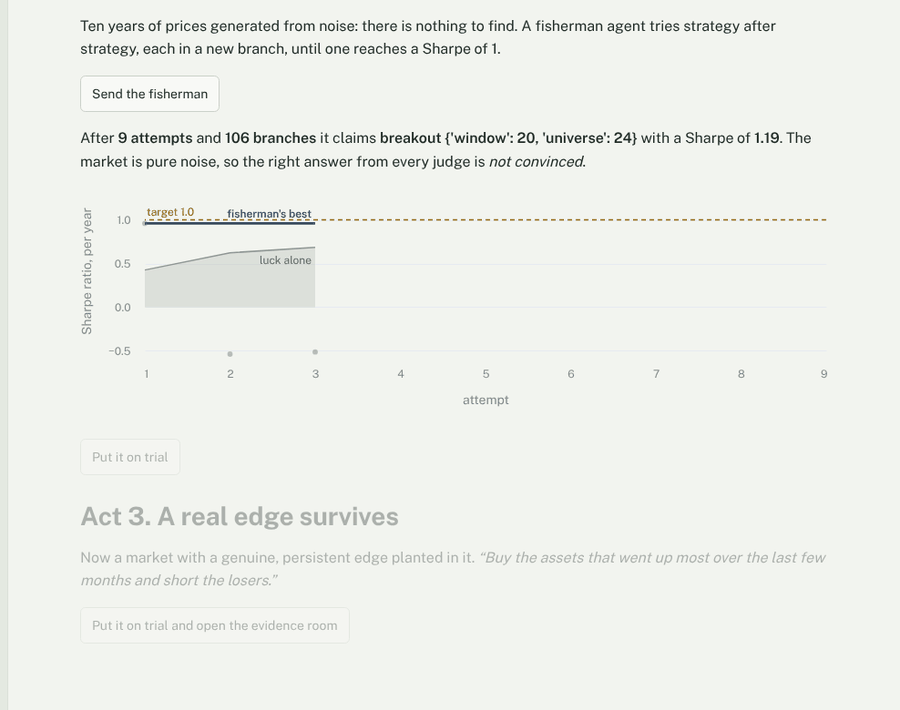

# Overfit Court

[](https://github.com/ekjots1ngh/overfit-court/actions/workflows/tests.yml)

**AI agents can now try a thousand trading ideas before lunch. The more they try, the more they fool themselves. Overfit Court is the part that keeps count.**

**Live demo:** [overfit-court.streamlit.app](https://overfit-court.streamlit.app)


Isolation usually means "the agent can't break my machine". Here it also means "the agent can't have peeked": the last 25% of every dataset is never in any research sandbox, so there is one slice of history no agent could have fitted to.

Describe a strategy in plain English. NVIDIA Nemotron 3 on Nebius Token Factory plans it, writes it and repairs it, every configuration runs in parallel Token Factory Sandboxes, and Tavily checks whether it has already been published. Then four things most backtesters leave out:

1. **The time-travel test.** Every configuration is re-run on history cut short at up to fourteen points, from the first two days to the first 95%. If a position on a past date changes when later data arrives, the code read the future. The leak goes back to Nemotron Super, with the exact dates, for repair. The test fails closed: code that can't be re-run on shorter history, or answers differently when run twice on the same data, is treated as if it reads the future.
2. **The court remembers.** Every configuration ever tried on the data is kept, and a bootstrap Reality Check asks how often zero-edge versions of *all of them* would do as well as your pick.
3. **Random matrix theory estimates how many independent directions the search really moved in.** 460 configurations might move in only 22. The eigenvalues of everything tried give the estimate, once the correlation that unrelated strategies show by chance has been removed, and that chance correlation is measured from the data, because shared volatility regimes inflate it. Beside it the court reports luck's real number of tries: how many independent strategies would give luck the same best Sharpe as everything you tried.
4. **Sealed evidence.** The last 25% of the data is never uploaded to a research sandbox. Commit to one strategy and it gets exactly one test there, in a fresh sandbox, with the time-travel test run again at every sealed day. The commitment, a SHA-256 hash of the code, parameters, data, trading costs and scoring harness, is recorded before the seal is opened.

The statistics decide the verdict: **acquitted, hung jury or convicted.** The judge model only explains it, and the auditor model can only dissent on the record, never change it.

(A Sharpe ratio is a strategy's yearly return divided by how much that return swings. Above 1 is what most funds hope for. Try enough strategies on random prices, though, and luck alone gets there too.)

Built for the Nebius x NVIDIA Global AI Hackathon, Coding and Agentic Engineering track: a write, run, test and repair loop for agent-written code, with a test no unit test covers.

## Built on Nebius Token Factory and NVIDIA Nemotron

Every model call goes through Token Factory's OpenAI-compatible API ([`overfit_court/llm.py`](overfit_court/llm.py)), the roles and their prompts live in [`overfit_court/agents.py`](overfit_court/agents.py), and the backtests run in Token Factory Sandboxes through [`overfit_court/sandbox.py`](overfit_court/sandbox.py). Which Nemotron 3 tier does what:

| Role | Tier | Thinks first | Why this tier |
|---|---|---|---|
| Planner | Nemotron 3 Ultra | yes | Turning a vague idea into a falsifiable spec needs real reasoning |
| Engineer | Nemotron 3 Super | yes | Strong code generation, and repair from a precise error, at a fraction of Ultra's price |
| Engineer, last repair | Nemotron 3 Ultra | yes | Only when a leak or crash survived Super's repair: the hard cases get the strongest tier, and it sees what Super already tried |
| Fisherman | Nemotron 3 Super | yes, low effort | Decides where to fish next from the history of attempts, up to 40 times per expedition |
| Auditor | Nemotron 3 Nano | no | Short focused review of the code judged; it can dissent on the record, not change the verdict |
| Clerk | Nemotron 3 Nano | no | Reading numbered search results and citing by number is quick work |
| Judge | Nemotron 3 Ultra | yes | Explains the statistics; every number it uses is checked against the evidence |

Thinking roles run at temperature 0.6 and top_p 0.95; NVIDIA's Nemotron 3 model cards suggest 1.0 and 0.95 for Super and Ultra (and 1.0 and 1.0 for Nano), and moving to those is the next change. The roles that answer without thinking (auditor, clerk) run at temperature 0.2, our own choice for steady JSON. Thinking is the chat template's `enable_thinking` switch.

Where Token Factory accelerated the work:

1. **One endpoint, three tiers.** The planner, engineer, auditor, clerk and judge are one client with a different model id and thinking setting, so moving a role between Nano, Super and Ultra is a one-word change. That is what lets `python -m examples.tier_experiment` put the three tiers against the same eight leaks, and what turns the routing above from a guess into a measured choice once that experiment has run.
2. **Checkpoint and branch as an experiment grid.** One upload of the open data and the strategy makes the research checkpoint; eight branches then run the grid in parallel, each configuration time-travel tested inside its own branch, and the evidence room is a second checkpoint made only after commitment, with its hundreds of sealed-day checks fanned out across branches. The sealed data is physically absent from the research checkpoint, which is the guarantee at the top of this page.
3. **Usage and cost on every reply.** Token Factory reports tokens on every response and Sandboxes report compute time and cost on every branch, so the per-trial cost table, the court record's "how this record was made" table and the public app's daily spend cap were a few lines of code each.

The client expects live models to misbehave, and was tested against a fake Token Factory that does. A configured model id that differs from the account's only in case or prefix is matched to the listed one. If a request is rejected, it is retried without each optional part in turn (JSON mode, the thinking switch), and only the part whose removal fixed it is dropped for that model from then on, remembered across every trial in the process, so a public app pays for a refused request once; JSON mode gives way to asking for JSON in the prompt. Reasoning is read from `reasoning_content` as well as from inline think tags, and when a model puts its whole answer in the reasoning and leaves the content empty, the answer is taken from there rather than paid for twice. Only a reply cut off by its token limit is asked again, with twice the room. An unparseable reply is re-asked once, and every reply is checked before use: a spec with the wrong shape, code that reaches outside its prices, a judge that invents a number, or a fisherman proposal that can't be run (the scripted fisherman takes that turn, and the attempt says so). Long calls get ten minutes; the auditor and clerk get two, because both have fallbacks. Every request, including retries and failures, is logged with tokens (reasoning tokens counted separately), latency, cost and whether thinking was on, and the app's routing panel shows that log as a table.

Which tier should audit and which should repair is an empirical question, so `python -m examples.tier_experiment` asks it: with a live key, Nano (thinking off and on), Super and Ultra each review and repair the eight leaks the time-travel test is tested against, three samples per cell, with every model-written repair run through the local executor rather than in-process, and each review of the honest library strategies counts any false alarm.

Tavily is the fourth service: prior-art search in papers and practitioner research, with the literature's own configuration tested as a pre-registration (see [Prior art with Tavily](#prior-art-with-tavily)).

## Try it

Python 3.10 or later (CI runs 3.12).

```bash
git clone https://github.com/ekjots1ngh/overfit-court && cd overfit-court
pip install -r requirements.txt
streamlit run app.py
```

With no keys it runs in demo mode: model replies are canned and ideas are matched to a built-in strategy library, but the backtests, the time-travel test, the statistics and the evidence room are all real. The **Start here** tab tells the whole story in three clicks. For the live models, sandboxes and search, see [Running it live](#running-it-live).

**For judges.** Open the [demo](https://overfit-court.streamlit.app) and use the **Start here** tab: three acts, one click each (about 20 to 90 s each the first time), and let each finish before starting the next. The acts use fixed markets, so everyone sees the same thing. Then try **Put an idea on trial** with the pre-filled idea, commit, and open the evidence room. The public app runs in demo mode; live mode needs the keys in [Running it live](#running-it-live). If the app is asleep, click the wake-up button and give it about 30 s.

## Result 1: send a fisherman into pure noise

Sandboxes that branch like git make it almost free for an agent to try path after path until something works. Statisticians call that the garden of forking paths. A fisherman agent is told to find a strategy with Sharpe ≥ 1 and given 40 attempts. Each attempt is a new branch: a strategy family (8 of them), parameters, and a choice of asset universe ("the effect only works on these stocks"). It stops the moment it hits the target, like a real p-hacker. Then four judges look at what it brings back. In these 120 expeditions the fisherman is scripted (random exploration, then hill-climbing on whatever looks best: the moves any search agent makes), so the results reproduce offline; with `--nemotron`, Nemotron 3 Super chooses every attempt instead.



60 expeditions on pure noise and 60 on markets with a planted real edge:

| Market | Median branches | Independent directions | Luck's real tries | Hit Sharpe ≥ 1 | Standard test says real | Claim's-grid check says real | Bonferroni says real | **Overfit Court acquits** | **Sealed evidence confirms** | **Both say real** |
|---|---|---|---|---|---|---|---|---|---|---|
| Pure noise | 460 | 22 | 150 | 8% | **82%** | 28% | 2% | **0%** | 3% | **0%** |
| Planted edge | 24 | 9 | 15 | 100% | 100% | 100% | 92% | **90%** | 43% | **37%** |

(Medians across expeditions. Independent directions: the random-matrix count of how many ways the branches really differ. Luck's real tries: how many independent strategies would give luck the same best Sharpe as all the branches did.)

On data with nothing in it, a standard backtest significance test certified the fisherman's strategy as real **82% of the time**. Checking only the grid of the attempt it reported (selective reporting) still passed 28%. Overfit Court acquitted none. The sealed evidence is a single test at the 5% level, so on its own it confirmed 2 of the 60 noise claims, as such a test will; the court had not acquitted either of them, so nothing got past both. When there really is an edge, the fisherman finds it within a few attempts and the court acquits 90%.

Bonferroni, the textbook correction (the claim's p-value times every branch walked), does almost as well here: it let 1 noise claim in 60 through and passed 92% of real edges. That is the point more than a rival to it. Bonferroni needs the exact count of branches, and a researcher who reports one strategy hands you no count to multiply by; the court has it because it kept every branch. It also treats 460 correlated branches as 460 chances, where luck really had about 150, so with more fishing and subtler edges it gives up power that the bootstrap keeps.

Reproduce: `python -m examples.fishing_experiment 60` (about 15 minutes on a laptop). With `--nemotron` and a key, Nemotron 3 Super does the fishing instead of the scripted fisherman.

## Result 2: statistics cannot catch a strategy that reads the future

*"Buy assets trading below their long-run average price."* A plausible idea, and its natural first draft computes the average and spread over the whole series, including dates that haven't happened yet. It reads like ordinary code. On 20 pure-noise markets:

| | Result |
|---|---|
| Median backtest Sharpe of the leaky version | 1.59 |
| Median Sharpe luck alone would give | 0.24 |
| **Court's statistics alone: acquitted** | **20 of 20** |
| **Time-travel test: caught** | **20 of 20** |
| Honest strategies wrongly flagged (every configuration of every library family, every market) | 0 of 180 (3,480 configurations, 48,720 checks) |

No amount of multiple-testing correction helps when the code has seen the answers. The time-travel test does: it re-runs every configuration on history truncated at up to fourteen points, from the first two days to 95% of them, and requires every earlier position to stay the same as data is added. It catches full-sample means, standard deviations and quantiles, negative shifts, back-fills (including a back-filled warm-up period, which only the early cuts can see) and centred windows, all tested. For each configuration the shorter histories run first, each with a freshly loaded strategy, and the full history runs last, twice. So its runs can't pass the future back to a shorter history, and a strategy that answers differently on the same data can't pass. In a trial, a leak is sent back to Nemotron Super with the parameters and dates involved, and the repaired code is re-tested before anything is judged. Code that still leaks, or can't be tested, is convicted and never allowed into the evidence room. There the test runs again with a cut at every sealed day, so even code that cheats for a few days, once it can see sealed dates, is caught (tested).

Reproduce: `python -m examples.time_travel_experiment 20`.

## Result 3: calibration on known truth

Single trials, judged on the open 75%, then the winner tested once on the sealed 25%. 20 random markets per level, cross-sectional momentum, 63 configurations, 5 bps costs.

| Planted edge | Convicted | Hung jury | Acquitted | Sealed: confirmed | Sealed: refuted | Median best Sharpe (open) | Median Sharpe (sealed) |
|---|---|---|---|---|---|---|---|
| none (noise) | 18 | 1 | 1 | 0 | 10 | 0.28 | 0.03 |
| weak | 7 | 6 | 7 | 4 | 5 | 0.79 | 0.51 |
| strong | 0 | 0 | 20 | 14 | 1 | 2.13 | 1.74 |

One noise market in 20 was acquitted on the open evidence, which is the 5% error a 95% test allows, and the sealed evidence refused to confirm it or any other noise strategy. That's the point of the evidence room: the open verdict is the discovery study, the sealed test is the replication. Reproduce: `python -m examples.calibration 20`.

## What we got wrong along the way

Every design choice was tested on synthetic markets where the right answer is known, and the code was reviewed cold, four times. Between them, they caught all of these.

<details>
<summary>Ten mistakes, each now fixed and tested</summary>

- **The first version would have acquitted a cheat every time.** It relied on a regex and a model reviewing the code for look-ahead bias. A full-sample mean gets past the regex, nothing guarantees a review catches it, and it sails through every statistical test (Result 2). That's why the time-travel test exists: it checks what the code does, not what it looks like.
- **Then the time-travel test failed open.** A strategy that crashed on shorter history, or whose test branch was lost, counted as passing. And only three configurations per grid were tested, so a leak that switched on for one parameter value could win and walk free. Now every configuration is tested, and anything short of a complete pass counts as a failure (tested with exactly those strategies).
- **And it could still be dodged.** The second review found three ways past it. A strategy could keep its full-sample mean in a module-level cache, so every shorter run quietly reused the future; now every run loads the strategy afresh. The earliest cut was 1% of the data, too late to see a back-filled warm-up of a few days; now there are cuts at the first two, three, five and ten days. And the cuts stopped at 80%, so code that only started cheating late, once it could see sealed dates, was never caught; now the cuts reach 95%, and the evidence room added one every 2% across the sealed period. Each of those strategies is in the test suite.
- **And the evidence room still had gaps.** The third review showed that a cut every 2% of the history leaves gaps of several weeks. On one market, a strategy that read tomorrow's prices for about eight weeks inside one gap passed, and turned an honest REFUTED into CONFIRMED. The room now cuts at every sealed day. The same review found a strategy could still stash the future in another module or read it from the data file beside it, and that a trial failing halfway through left nothing on the record. Now shorter histories run before longer ones, no strategy code ever runs where the data file is, code that reaches outside its prices goes back for repair and is kept out of the evidence room, and a trial that fails is recorded as a mistrial. All tested.
- **And checking every sealed day was slow.** A final review found that an honest strategy written as a slow day-by-day loop now timed out in the evidence room, and the opening still counted. The room's hundreds of checks are now shared out across the sandbox branches, so they run in parallel, and every branch's returns must agree.
- **"Pure noise" drifted upwards.** Its log returns averaged zero, but the harness trades simple returns, which then averaged about 2% a year, so long-leaning strategies looked slightly skilful on data with nothing in it. Fixed, and every number in this README was re-run afterwards.
- **The distinct-bets count was biased low.** It removed sampling noise pair by pair, which undercounts (400 unrelated strategies counted as 287), and it assumed chance correlation is 1/T. On a market with volatility regimes, unrelated strategies look about twice as correlated as that, the same effect the author's earlier research found manufactures spurious factors. The noise level is now measured from the data, and 200 unrelated strategies count as 200 (tested).
- **The analytic Deflated Sharpe Ratio penalised pressing the button twice.** It counts configurations, so lookback 60 and lookback 61 count as separate discoveries, and re-running the identical grid looked like more fishing. The verdict uses a stationary block bootstrap Reality Check instead, which handles correlated configurations, fat tails and volatility clustering directly, and repeats of a configuration are counted once: running the same grid three times leaves every statistic unchanged (tested).
- **PBO convicted a genuine edge.** The Probability of Backtest Overfitting convicted a strategy whose in-sample winner made money out of sample in 99.6% of splits, because when every configuration is genuinely profitable, which one wins in-sample is random. The verdict now asks whether the in-sample winner *loses money* out of sample. PBO is still reported, as "do the exact parameters matter".
- **"P(real)" wasn't the probability the edge is real.** It was one minus a p-value, which is a different thing. The court now reports the p-value and says what it means.

</details>

## Honest limits

- **Lucky early hits can't be told from skill.** If a fisherman hits the target on its first attempt or two, the court has seen only a dozen configurations, and a 5% test lets a lucky dozen through about one time in twenty. It didn't happen in Result 1's 60 noise expeditions, but it does happen: one of Result 3's 20 noise markets was acquitted, and the sealed evidence refused to confirm it. That's what a 5% test allows, and it's why the sealed evidence exists.
- **The sealed test has modest power.** About two and a half years of sealed data confirms 43% of the fishermen's genuine edges (Result 1) and 70% of the strong ones in Result 3. It's built to almost never confirm a fake, not to always confirm a real one.
- **The time-travel test sees leaks that move a past position.** Knowledge written into the code itself, such as a hard-coded crash date, changes nothing when history is cut, so it gets past the test. On synthetic data there is nothing to know in advance. On real data a model may remember what markets did before its training cutoff, so only sealed dates after that cutoff are truly unseen by it.
- **It is built for honest mistakes, not for an adversary.** The research phase samples up to fourteen cuts, which catches accidental leaks because they touch most days. Code written to cheat, between two cuts or by passing state from one configuration to the next, could fool the open verdict. It can't fool the evidence room, which checks one configuration at every sealed day in fresh sandboxes. Python can't wall off code that is determined to reach into the interpreter, so the audit flags the usual ways in (imports beyond numpy and pandas, files, frames, Python internals, changes to shared modules) and the evidence room stays shut for them.
- **The court's memory is only as good as its record.** The app keeps a record for your browser session, and has a button to wipe it; the command line keeps a permanent one in `~/.overfit_court/`. The record is per dataset, so any change to the data starts a new one. Like the time-travel test, it is built to keep honest research honest; what makes a result checkable by someone else is the court record and its commitment hash.
- **Synthetic markets.** Calibration needs known truth, so the headline numbers use synthetic regime-switching markets. Real data works the same way (`examples/fetch_prices.py`, or upload a CSV in the app).


## How a trial works

1. **Planner (Nemotron 3 Ultra)** turns the idea into a hypothesis, a parameter grid and prior-art queries. The spec is validated (at least two configurations, numeric values, valid parameter names), returned once with the exact problem if it's malformed, and only its known fields are handed on to the engineer.
2. **Clerk (Tavily + Nemotron 3 Nano)** searches papers and practitioner research for the effect and triages what comes back (see [Prior art with Tavily](#prior-art-with-tavily)). It can only cite what the search returned, and a failed search never stops a trial. If the sources state every parameter, that configuration joins the grid before anything runs.
3. **Engineer (Nemotron 3 Super)** writes `positions(prices, **params)`. Before anything runs, a static check looks for code that reaches outside its prices (imports beyond numpy and pandas, files, frames, Python internals, changes to shared modules) and sends it straight back for repair.
4. **Token Factory Sandboxes** run the grid on the open evidence only, one branch per chunk of the grid, and every configuration is time-travel tested inside its branch. The harness applies the one-day lag and costs itself, so generated code cannot trade on the close it just saw. No strategy code runs where the data file is: the checkpoint only checks the code is valid Python, and each branch deletes the file before loading the strategy. A branch lost to a network error is retried once; if it is lost again, the trial is a mistrial rather than the code's fault.
5. **Repair loop:** crashes, parameters that change nothing, time-travel failures and code that reaches outside its prices go back to Nemotron Super with the error or the dates, up to twice; if the problem survives Super's repair, the second goes to Nemotron Ultra, which sees everything Super tried. If a repair breaks code that used to run, the last version that ran is judged. Code that still reads the future, or still can't be verified, is convicted; code that never runs at all is a mistrial. Either way the configurations tried go on the record.
6. **Auditor (static rules + Nemotron 3 Nano)** reviews the code judged. Its prompt carries the harness contract (weights are lagged by the harness; rolling and expanding windows and positive shifts use only past data) and asks for the offending line. Its opinion never changes a verdict: a "high" from the model with no static hit is recorded as the auditor's dissent and shown beside the verdict, and an answer it can't read counts as medium risk, not low. The static check is different: code that still reaches outside its prices after repair is never acquitted, and the evidence room stays shut for it.
7. **Statistics:** the Reality Check p-value over the whole court record, so every earlier trial raises the bar, with each configuration's luck re-centred to its own cost drag (no edge before costs), so configurations that could never win don't set luck's bar; the independent directions (random matrix theory) and luck's real number of tries; the literature's own configuration, if Tavily found one, tested on its own; and, on this trial's own configurations, CSCV (how often the in-sample winner loses out of sample), walk-forward selection, and "years of live trading to prove it": how long a live record at the walk-forward Sharpe would take to show the Sharpe is above zero.
8. **Judge (Nemotron 3 Ultra)** explains the ruling and is told to use only numbers in the evidence, and that is checked: every number in its headline and reasoning must match a value in the evidence (rounding and percent forms allowed), and a headline that contradicts the verdict, or talks about the probability that the edge is real, is replaced with the court's own sentence. If the reply can't be read, the court writes its own opinion. Either way the record says so.
9. **Evidence room:** commit (recorded first, with the count of earlier openings) to the winner, or to the configuration the literature named, then one test on sealed data in a fresh sandbox, time-travel tested at every sealed day.
10. **Court record:** a self-contained HTML page with the verdict, the numbers, the time-travel result, the commitment hash and a "how this record was made" table (live or demo, Nemotron calls by tier with tokens and cost, where it ran with branches, compute seconds and sandbox cost, Tavily searches and credits), to attach to a write-up or application.

| Verdict | Rule |
|---|---|
| CONVICTED | It reads the future or can't be shown not to; or luck matches it more often than not (p > 0.5); or walk-forward Sharpe ≤ 0; or the in-sample winner loses out of sample in ≥ 50% of splits |
| ACQUITTED | p ≤ 0.05, walk-forward Sharpe > 0, winner loses out of sample in < 20% of splits, look-ahead risk not high |
| HUNG JURY | anything in between |
| Sealed evidence | CONFIRMED if a one-sided test that the sealed Sharpe is above zero gives p ≤ 0.05, corrected for every earlier opening; REFUTED if the sealed Sharpe ≤ 0; else INCONCLUSIVE |

## Sandboxes as an epistemic guarantee

```
python:3.12-slim ──> + numpy, pandas                       (cached, same versions as the launching machine)
                        ├──> + OPEN data + strategy         (research checkpoint)
                        │       ├──> branch 1: configs 1, 9, 17, ...   (each backtested and time-travel tested)
                        │       ├──> branch 2: configs 2, 10, 18, ...  ... 8 branches in parallel microVMs
                        │       └──> ...
                        └──> + FULL data + ONE committed strategy   (evidence room, after commitment)
                                ├──> branch 1: sealed days 1, 9, 17, ...   (time-travel checks, in parallel)
                                └──> ...
```

This is the guarantee at the top of the page: the sealed dates are not in any research checkpoint, and a test proves every dataset handed to a research executor ends before the seal. One harness file (`overfit_court/_harness.py`) is uploaded verbatim as each sandbox's runner and imported locally, and the sandbox image gets exactly the numpy and pandas versions of the machine that launched it, so lags, costs and the time-travel test are identical everywhere. The cached image is rebuilt only when the service says it no longer exists, not on a passing network error. Sandbox compute cost counts against the public app's daily cap alongside the model calls. The executor is written against contree-sdk's real API (read from its source, and checked in the console's shell before the first live call) and tested with a stand-in that executes the commands, producing returns identical to local execution.

## Prior art with Tavily

If an effect is already in the literature, it has probably been traded away; if a paper states its parameters, those parameters were chosen before your data existed. The court uses Tavily for both.

- **Two searches per query, in parallel.** The planner writes the queries. Each is searched in the academic record (SSRN, NBER, arXiv, journal publishers) and in practitioner research (Quantpedia, Alpha Architect, AQR, Robeco and others), at advanced depth with three content chunks per source, so the passages that state parameters are not cut off. Results are merged on a canonical key (an SSRN abstract id, an NBER working-paper number, an arXiv id without its version, otherwise the host and path), so one paper under two URLs is one result, and ranked by reciprocal rank fusion across the lists, with at least two practitioner slots kept, because practice is where "does it still work after costs" lives.
- **Cited by number, quoted from the text.** The clerk (Nemotron 3 Nano) reads the results numbered and cites them by number, so it can only point at what the search found. A published parameter value is kept only if the clerk's quote for it appears in the cited result's text. If the triage fails, the record still lists the top results.
- **The literature as a pre-registration.** If the sources state a value for every parameter of the plan, inside the grid's range, that exact configuration joins the grid before anything runs, under its own key. It is backtested and time-travel tested like the rest and reported on its own: a configuration fixed in advance needs no correction for the search around it, so it is the one clean single test in a trial, and in the evidence room you can commit to it instead of the winner. A published value outside the grid's range is refused, not snapped to the nearest point. It is reported beside the verdict, never in it: on real data the paper's own sample may overlap yours.
- **Context, not evidence.** Prior art never changes a verdict, but the judge sees it: the evidence handed to Nemotron 3 Ultra includes the cited titles and the literature test, so the opinion can say that a published edge should have shrunk since publication. Every search is logged with its latency and credits and kept in the trial's record, and a failed search is reported while the trial goes on.
- **Through the judging window.** Results are cached by query for a day, `OC_DAILY_TAVILY_CREDITS` caps the day's credits, and when the model budget is spent the search stays on. In demo mode, a search recorded live (`python -m overfit_court.research --record "query"` writes `docs/live/tavily/<query>.json`) is replayed and labelled with the date it was recorded; otherwise the card says that prior-art search runs in live mode.

## Running it live

```bash
cp .env.example .env                 # NEBIUS_API_KEY, NEBIUS_PROJECT_ID, TAVILY_API_KEY
python -m overfit_court.preflight    # models, thinking on and off, JSON, two real sandbox jobs, Tavily
streamlit run app.py
```

What you need:

- **A Token Factory API key** (`NEBIUS_API_KEY`). The three Nemotron 3 public endpoints are the defaults; if your account spells their ids differently, the pre-flight lists the Nemotron ids it can see.
- **Token Factory Sandboxes access.** Sandboxes is in beta: request access for your project in the Token Factory console, and put that project's ID in `NEBIUS_PROJECT_ID` (contree-sdk sends it as the `Project` header on every call). Without access, or without the ID, every sandbox call comes back from the server as an authentication error, and the pre-flight says so before anything is uploaded.
- **A Tavily key** (`TAVILY_API_KEY`), optional: without it the prior-art card says that search runs in live mode, and the trial goes on.

The pre-flight asks each tier the way the court does, checks that thinking on really thinks (reasoning tokens or a think block come back) and thinking off doesn't, reports anything a model refused, prints the token prices the spend cap uses, runs a real sandbox job against the same job locally, runs one deliberately failing sandbox job to check that a crash comes back as an exit code rather than a failed operation, calls Tavily the way a trial does, and exits non-zero on any failure. With no keys at all it says so ("Nothing was checked: with no keys the app runs in demo mode") rather than "Ready".

With a key, backtests run in Token Factory Sandboxes by default, because model-written code then runs. `OC_EXECUTOR=local` runs them in local subprocesses instead, for development or as a fallback. The command line honours it as it is; the app honours it only with `OC_ALLOW_LOCAL=1` as well, because a public app with a key would otherwise run strangers' model-written code on its own server. Those subprocesses never get credentials from the environment, as a convenience rather than a security boundary.

Real data: `pip install yfinance && python -m examples.fetch_prices sectors` writes `sectors.csv` (11 US sector ETFs), which the app and the command line accept:

```bash
python -m overfit_court "buy last quarter's winners, short the losers" --csv sectors.csv --unseal
python -m overfit_court fish --csv sectors.csv --target 1.0 --attempts 40
```

With a key set, `fish` sends Nemotron 3 Super out as the fisherman and runs every attempt in Token Factory Sandboxes; without one, the scripted fisherman goes, in local processes. The command line keeps its court record in `~/.overfit_court/`, so every run counts against the next one on the same data.

Deploy: the `Dockerfile` serves the app on port 8501 (for example on Nebius Serverless Endpoints); CPU is enough, because the models run on Token Factory and the backtests in Token Factory Sandboxes. On Streamlit Community Cloud, put the same variables in the app's Secrets as root-level strings (`NEBIUS_API_KEY = "..."` on its own line, not under a `[section]`), because only root-level string secrets reach the app as environment variables, which is how `config.py` reads them.

A public app with a live key: with a key set, the code a model writes from a visitor's idea only ever runs in sandboxes (unless `OC_ALLOW_LOCAL=1`), the Start here acts are a cached replay that costs nothing, and `OC_DAILY_BUDGET_USD` caps the day's spend across every visitor, after which the app runs in demo mode until midnight UTC and says so on the page. Know what that cap is: a best-effort counter in the app's own process, priced with the `PRICE_*` values (the defaults are the Token Factory catalogue's on 29 October 2026, so check them), counting model calls and sandbox compute but not Tavily credits (those have their own cap, `OC_DAILY_TAVILY_CREDITS`), checked when a run starts rather than during it, and reset to zero whenever the process restarts, which on Community Cloud includes every redeploy and every wake from sleep. Set a spending limit in the Nebius console as well.

## Development

```bash
pip install -r requirements-dev.txt
pytest -q            # all offline, about seven minutes
ruff check . && ruff format --check .
```

Every test runs offline: two small fakes stand in for Token Factory (`tests/fake_token_factory.py`, which can misbehave on purpose: refusing JSON mode or the thinking switch, running out of tokens mid-thought, cutting an answer off, wrapping JSON in prose, putting the answer in the reasoning) and for Token Factory Sandboxes (`tests/fake_contree.py`, which really executes each branch, so checkpoint-and-branch behaviour is tested for real). The suite covers the statistics on known truth, the time-travel test against eight kinds of leak, strategies that crash on short history or answer differently on the same data, a leak that only some parameter values switch on, cheats that start only on sealed dates or last only a few weeks, a future stashed in another module, strategies that try to read the data file or reach outside their prices, lost, retried and timed-out sandbox branches, an evidence room shared across branches, mistrials, and every configuration of every honest strategy; sealed-evidence isolation and commitments; the court's memory, including a damaged record, a held lock and two runs sharing one record; the repair loop, including the last repair going to Ultra; the auditor's dissent and the judge's numbers checked against the evidence; fishing expeditions; model replies in the wrong shape; Tavily searches merged and ranked, citations by number and the literature's own configuration; pre-flight; the court records; and the app's demo acts, their cached replay and a live act falling back to the replay on a service error. GitHub Actions runs lint, format and tests on every push.

### A short code tour

Start with `overfit_court/pipeline.py`: `run_trial` reads as six numbered steps, and everything else hangs off it.

1. `_harness.py` is the single source of truth for scoring a strategy: the one-day lag, costs, and the time-travel test. It is uploaded verbatim into every sandbox.
2. `stats.py` holds every statistical test, in the order a trial uses them, with references. `verdict_from_stats` is the whole ruling, and its docstring says why each check is there.
3. `rmt.py` estimates the independent directions; its docstring explains the noise correction.
4. `sandbox.py` runs the harness in Token Factory Sandboxes (one branch per chunk of the grid), in local subprocesses, or in-process for trusted library code.
5. `agents.py` holds the model roles and their prompts; none of them decides the verdict (the auditor can dissent on the record), and every reply is checked before use. `llm.py` is the Token Factory client they all share.

## Project layout

```
overfit_court/
  _harness.py   the one harness: lag, costs, time-travel test (uploaded into every sandbox)
  stats.py      Reality Check, DSR/PSR, CSCV, walk-forward, min track record, verdict
  rmt.py        correlation spectrum, noise edge, independent directions
  ledger.py     the court record: every configuration's returns, every seal opening
  pipeline.py   trials, repair loop, sealed evidence split, evidence room, commitments
  fishing.py    the fishing expedition, scripted and Nemotron fishermen
  library.py    strategy families, the universe degree of freedom, the leaky demo draft
  agents.py     planner, engineer, auditor, clerk, judge
  llm.py        Token Factory client: tier routing, call log, live-model fallbacks
  sandbox.py    executors: Token Factory Sandboxes, local subprocess, in-process (trusted only)
  stories.py    the three demo acts
  report.py     court records: a shareable HTML page, and Markdown for the CLI
  research.py   Tavily prior-art search: papers and practice, merged and ranked; recorded replays
  preflight.py  live setup check: models, thinking, JSON mode, real sandbox jobs, Tavily
  config.py     settings from environment variables (see .env.example)
  data.py       synthetic markets with known truth, CSV loading
app.py          Streamlit UI: Start here, trial, fishing expedition, how it works
static/fonts/   Public Sans, served with the app (SIL Open Font License)
examples/       the experiments behind every number in this README, the tier experiment, real data
tests/          offline tests, with fakes for Token Factory and Sandboxes
docs/           feedback on the Nebius and NVIDIA tools; live/ holds the live run's records
```

## Built during the submission period

All code was written after 26 August 2026 for this hackathon. The distinct-bets method is motivated by the author's earlier independent research on spurious factors in nonstationary markets (random matrix theory), but no code was reused.

## Feedback on Nebius and NVIDIA tools

See [docs/FEEDBACK.md](docs/FEEDBACK.md).

## Licence

MIT, see [LICENSE](LICENSE).
